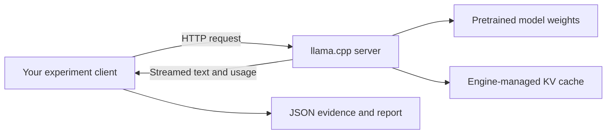

# LLM Serving Lab

A guided systems lab for software engineers who are new to machine learning. Run a small pretrained model, observe its streamed responses, measure it carefully, and explain how concurrency affects a serving system.

**Start with [Lab 00: foundations](labs/00-foundations.md).** You do not need to implement attention, build a KV cache, train a model, or rent a GPU. The first milestone is one successful local request. Use **llama.cpp** for the core lab; **vLLM is an optional later extension**, not a second prerequisite.

## What you will learn

- Distinguish model weights, an inference engine, an HTTP server, and your client.
- Explain tokens, prefill, decode, and KV caching at the level needed to interpret serving behavior.
- Capture streaming responses without confusing network chunks with model tokens.
- Design controlled latency and throughput experiments, retain failures, and recognize confounding factors.
- Produce a reproducible report with raw evidence, limitations, and defensible conclusions.



## Course map

Each lab contains objectives, readings, explained steps, deliverables, and completion criteria. Budget approximately **8–15 hours** for the core sequence, split into manageable sessions; this is an estimate, not a deadline.

| Lab | Main question | Deliverable |
| --- | --- | --- |
| [00 — Foundations](labs/00-foundations.md) | What executes when a model answers? | Your own glossary and request diagram |
| [01 — Local serving](labs/01-local-serving.md) | Can I run and query one model? | Environment record and first live capture |
| [02 — Measurement](labs/02-measurement.md) | What do my timestamps actually measure? | Validated captures and metric audit |
| [03 — Controlled experiments](labs/03-controlled-experiments.md) | How do prompt and output lengths affect behavior? | Repeated trials and a confound analysis |
| [04 — Concurrency](labs/04-concurrency.md) | What happens when requests overlap? | Concurrency sweep and tradeoff discussion |
| [05 — Capstone](labs/05-capstone.md) | Can another engineer audit my conclusion? | Code change, tests, and final report |

Continue with [extensions](docs/extensions.md) only after the core measurements make sense.

## Repository quick start

```sh
git clone https://github.com/yijiem/llm-serving-lab.git
cd llm-serving-lab
python3 -m serving_lab doctor
python3 -m unittest discover -s tests -q
```

Python **3.9+**, Git, and a terminal are sufficient for the included tools and offline tests. No pip packages, API account, GPU, or model download are needed for those tests. For actual inference follow [setup](docs/setup.md), then Lab 01. The default model download is approximately 491 MB; model runtime memory is additional.

After starting the server and preparing your environment record:

```sh
python3 -m serving_lab check-server
python3 -m serving_lab capture --model lab-model --prompt-file prompts/short.txt --environment configs/environment.json --output runs/first.json
python3 -m serving_lab validate runs/first.json --require-live --require-success
python3 -m serving_lab summarize runs/first.json
```

Commands refuse to overwrite existing evidence. Choose a new filename for each trial. `python3 -m serving_lab --help` lists commands.

## What is supplied, and what you do

The repository supplies the syllabus, setup helper, a streaming measurement client, validators, offline tests, and report templates. **It contains no completed learner experiment or real-model benchmark result.** You run the model, make predictions, inspect evidence, explain surprising results, and implement a small extension in the capstone. This is a lab kit, not a claim of completed coursework.

| Path | Purpose |
| --- | --- |
| `serving_lab/` | Standard-library client, experiment runner, validator, and summaries |
| `tests/` | Synthetic protocol, failure, timing, and artifact tests |
| `configs/assets.lock.json` | Pinned engine/model URLs, sizes, and SHA-256 hashes |
| `configs/environment.example.json` | Copy and fill in actual runtime settings |
| `prompts/` | Small synthetic workloads safe to share |
| `runs/` | Ignored raw output, logs, and scratch results |
| [work/](work/README.md) | Your code and notes |
| [submissions/](submissions/README.md) | Deliberately selected, reviewed evidence and reports to commit |
| [templates/](templates/) | Prelab and report starting points |

## Verification and Codex

Read [verification](docs/verification.md) and [working with Codex](docs/using-codex.md). Open this repository as a separate project and ask Codex to follow [AGENTS.md](AGENTS.md).

**Verification does not require identical generated text.** Deterministic fixtures test the client and calculations. Live checks test evidence consistency: request accounting, timestamp ordering, usage arithmetic, and stream completion. Your report evaluates experimental quality. Neither a passing validator nor a fixed random seed proves that conclusions are correct, that a model ran, or that timing will repeat exactly.

## Sources and scope

Setup pins were checked against official llama.cpp release metadata and the Qwen model repository on **2026-11-12**. Each lab links its primary learning sources. Upstream software and hardware evolve; record any departure from the baseline rather than silently replacing versions. This repository is an independent learning exercise, not an official university course or a company interview specification.

Lab code and original instructional material are MIT licensed. Downloaded software and model weights retain their upstream licenses; see [setup](docs/setup.md).

[Initial maintainer validation](docs/maintainer-validation.md) records which toolkit checks were executed and which live-model experiments remain for the learner.
